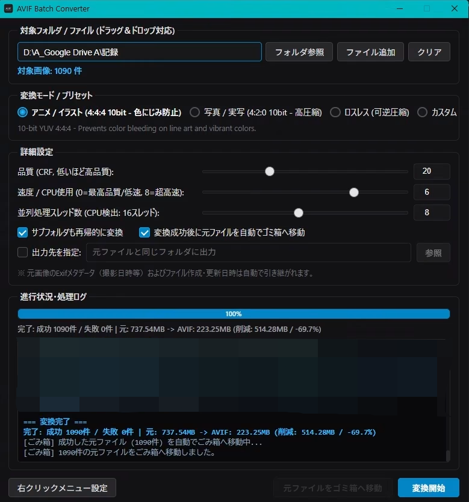

# To-avif (AVIF Batch Converter)

SVT-AV1 エンコーダーを採用した、Windows 向けの高速・軽量な AVIF 一括画像変換 GUI ツールです。

<p align="center">
  
</p>

---

## 主な特徴

- **Rust製**: 高速起動
- **幅広い入力フォーマット**: JPEG, PNG, WebP, BMP, TIFF に加え、スマートフォン写真の HEIC / HEIF や次世代画像 JPEG XL (JXL) からの一括変換に対応。
- **最適化プリセット**:
  - **アニメ / イラスト**: 10-bit YUV 4:4:4。細い線画や鮮やかな色境目の色にじみ・劣化を防止。
  - **写真 / 実写**: 10-bit YUV 4:2:0。人間の視覚特性に最適化し、高い圧縮率を達成。
  - **ロスレス**: 可逆圧縮モード。元画像のピクセル情報を完全保持。
  - **カスタム**: CRF（品質）、CPUプリセット速度、スレッド数を自由に調整可能。
- **メタデータ・日時の完全保持**:
  - ExifTool のバッチ一括同期パイプラインにより、Exif/メタデータを高速かつ確実に引き継ぎ。
  - ファイルの作成日時（CreationTime）および更新日時（LastWriteTime）を自動復元。
- **エクスプローラー右クリック連携**: フォルダやドライブを右クリックして「AVIFに一括変換 (GUI)」からダイレクトに対象フォルダを読み込んで起動可能。
- **ポータブル設計**: 依存ツール（FFmpeg, ExifTool）をアプリ配下の `bin/` フォルダから優先探索するため、環境変数 PATH を汚さず、フォルダ移動やUSB持ち運びに対応。
- **安全な後処理**: 変換成功後に元ファイルを自動でWindowsの「ごみ箱」へ退避する機能を搭載。

---

## 動作要件

- **OS**: Windows 10 / 11 (64-bit)
- **依存バイナリ**:
  - `ffmpeg.exe` (libsvtav1 対応ビルド)
  - `exiftool.exe`
  ※付属の `setup.bat` を実行することで、自動的に最新版が `bin/` フォルダへ配置されます。

---

## 使い方

### 1. 自動セットアップ
ZIPダウンロード後、フォルダ内の `setup.bat` を実行します。
1. 必要なディレクトリ構成を自動検証します。
2. `bin/` フォルダに必要な外部ツール（FFmpeg / ExifTool）を自動取得・展開します。
3. Windows のエクスプローラー右クリックメニューに本ツールを自動登録します。

### 2. 実行方法
以下のいずれかの方法で起動できます：
- フォルダまたはファイルを右クリックし、その他のオプションから「AVIFに一括変換 (GUI)」 を選択。
- **`to-avif.exe`** を直接ダブルクリック。
- **`run.bat`** を実行。

### 3. 操作手順
1. **対象指定**: フォルダ参照ボタン、ファイル追加ボタン、またはウィンドウ内へのドラッグ＆ドロップで対象を指定。
2. **プリセット選択**: アニメ、写真、ロスレス等から用途に合わせて選択。
3. **変換開始**: 「変換開始」ボタンをクリックすると、並行マルチスレッドで高速に変換が行われます。

---

## 開発・ビルド手順

本リポジトリからソースコードをビルドする場合は、以下の手順を実行します。

### 前提条件
- [Rust](https://www.rust-lang.org/) (stable)
- Node.js は不要（純粋な HTML/CSS/JavaScript + Rust Tauri の軽量構成）

### ビルド実行
ルートディレクトリで `build.bat` を実行するか、以下のコマンドを実行します：

```bash
cargo build --release --manifest-path src-tauri/Cargo.toml
```

ビルドが完了すると、`src-tauri/target/release/to-avif.exe` が生成されます。

---

## ライセンス

本プロジェクトは [MIT License](LICENSE) のもとで公開されています。
